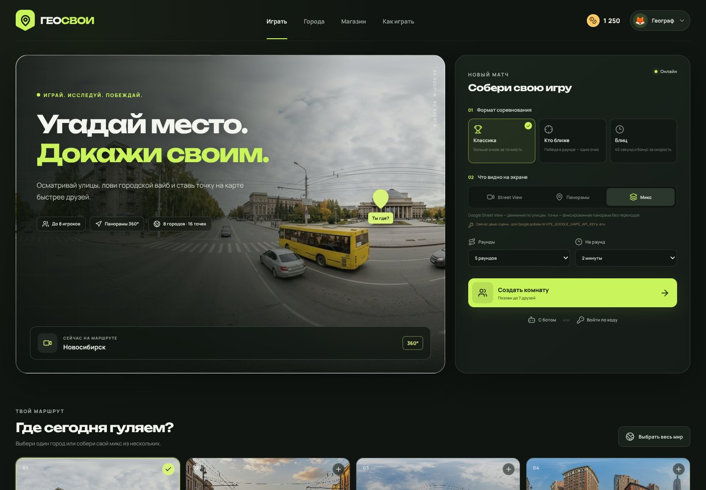

# ГЕОСВОИ 🌍

**Мультиплеерная географическая игра с друзьями:** исследуйте Google Street View, угадывайте точки на карте, используйте гаджеты и докажите, кто в компании лучше всех знает города.

[](https://github.com/romanata10/the-street-view-game-by-ai-/actions/workflows/ci.yml)
[](https://github.com/romanata10/the-street-view-game-by-ai-/releases)
[](https://nodejs.org/)



## Что внутри

- **Комнаты до 8 игроков:** приглашение ссылкой или шестизначным кодом, готовность, чат, реакции и переподключение.
- **8 городов и 16 локаций:** Новосибирск, Омск, Москва, Санкт-Петербург, Нью-Йорк, Токио, Париж и Стамбул. Можно выбрать один город, собрать микс или играть весь мир.
- **Google Street View:** движение по улицам или фиксированные точки без переходов. Есть встроенные резервные 360°-сцены.
- **Три формата:** «Классика», «Кто ближе» и «Блиц» на 45 секунд.
- **«Погуляй с другом»:** свободные совместные прогулки без таймера, ответов и очков. Можно менять места независимо, переходить к другу и подключаться после старта.
- **Избранные панорамы:** сохраняются в браузере; для Google запоминаются точный `panoId` и направление взгляда.
- **Присутствие друзей:** направления взгляда в панораме и курсоры на мини-карте. Во всех режимах есть статус и уведомление «в том же месте».
- **Очки и магазин:** подсказки, чёрный экран сопернику, ускорение, щит, удвоение очков и постоянная Оптика PRO.
- **Результаты:** расстояния, правильная точка, ответы всех игроков, монеты и финальный подиум.
- **Без регистрации:** профиль и рюкзак сохраняются в браузере.
- **Обучение в игре:** вкладки «Основы», «С друзьями», «Прогулка», «Гаджеты» и «Скачать» с пошаговой установкой.
- **Русский адаптивный интерфейс:** компьютер, планшет или телефон.

## Как играть вместе с другом

> Полная инструкция с картинками и решением проблем: [docs/HOW_TO_PLAY.ru.md](docs/HOW_TO_PLAY.ru.md).

1. **Хост открывает приложение**, выбирает имя, города и правила, затем нажимает **«Создать комнату»**.
2. В лобби хост нажимает **«Скопировать ссылку»** и отправляет её другу. Можно вместо этого продиктовать код комнаты.
3. **Друг открывает ссылку** или выбирает **«Войти по коду»** на главной странице.
4. Гость нажимает **«Я готов играть»**. Хост дожидается готовности всех и нажимает **«Начать матч»**.
5. Все получают одинаковую локацию. Исследуйте её, ставьте точку на карте и нажимайте **«Это здесь!»**.
6. Раунд заканчивается после всех ответов или по таймеру. Хост открывает следующий раунд, а после последнего — итоги и реванш.

**Нужен быстрый тест без второго человека?** Нажмите **«С ботом»** на главной странице.

## Скачать приложение

В меню игры нажмите **«Скачать»**: там показаны архивы и пошаговая установка.

- [Production ZIP 1.1.1](https://github.com/romanata10/the-street-view-game-by-ai-/releases/download/v1.1.1/geosvoi-1.1.1-production.zip) — готовый клиент и сервер, команда `npm run build` не нужна.
- [Production TAR.GZ 1.1.1](https://github.com/romanata10/the-street-view-game-by-ai-/releases/download/v1.1.1/geosvoi-1.1.1-production.tar.gz) — тот же набор файлов для Linux и macOS.
- [ZIP с последними исходниками](https://github.com/romanata10/the-street-view-game-by-ai-/archive/refs/heads/main.zip) — для разработки и своей сборки.
- [Последний релиз](https://github.com/romanata10/the-street-view-game-by-ai-/releases/latest) — все архивы и SHA-256.
- [Полная инструкция по скачиванию](docs/DOWNLOAD.ru.md) — установка, запуск, подключение друга и решение ошибок.

RAR не нужен: ZIP открывается стандартными средствами Windows, macOS и Linux.

## Быстрый запуск локально

Требуется **Node.js 20.19+** (рекомендуется Node.js 22).

```bash
git clone https://github.com/romanata10/the-street-view-game-by-ai-.git
cd the-street-view-game-by-ai-
npm ci
npm run dev
```

Откройте **http://localhost:3000**. Сервер слушает `0.0.0.0`: при игре в локальной сети друзья могут открыть IP-адрес вашего компьютера с портом `3000`, если он разрешён firewall.

Для игры через интернет опубликуйте приложение на сервере или используйте Docker — один процесс обслуживает сайт и WebSocket на одном домене.

## Google Maps API

Без ключа игра запускается со встроенными иллюстративными панорамами. Для настоящих Google-сцен:

1. Включите **Maps JavaScript API** в Google Cloud.
2. Создайте браузерный ключ и ограничьте его доменами приложения.
3. Создайте `.env` по примеру `.env.example`:

```env
VITE_GOOGLE_MAPS_API_KEY=ваш_браузерный_ключ
PORT=3000
```

4. Перезапустите `npm run dev`. Для production выполните сборку заново.

**Подробная настройка и ошибки:** [docs/GOOGLE_MAPS.ru.md](docs/GOOGLE_MAPS.ru.md). Ключ не отправляйте в чат и не коммитьте `.env`.

## Docker

```bash
docker compose up --build
```

Приложение будет доступно на **http://localhost:3000**. Для другого порта:

```bash
APP_PORT=8080 docker compose up --build
```

Google-ключ можно передать на этапе сборки:

```bash
VITE_GOOGLE_MAPS_API_KEY=ваш_ключ docker compose up --build
```

Production без Docker:

```bash
npm ci
npm run build
npm start
```

Healthcheck: **GET `/api/health`**. Подробнее: [docs/DEPLOYMENT.ru.md](docs/DEPLOYMENT.ru.md).

## Управление

| Действие | Управление |
|---|---|
| Осмотреться | Мышь, палец или стрелки / WASD во встроенной камере |
| Приблизить | Колесо мыши или контролы Google |
| Поставить/передвинуть ответ | Клик по карте |
| Отправить ответ | «Это здесь!» или **Enter** |
| Развернуть карту | **M** или кнопка над картой |
| Использовать гаджеты | Клавиши **1–5** или панель слева |
| Реакция | Эмодзи в левом нижнем углу |

## Документация

| Документ | Содержание |
|---|---|
| [Как играть с друзьями](docs/HOW_TO_PLAY.ru.md) | Комната, приглашения, прогулка, режимы, гаджеты, FAQ |
| [Скачать приложение](docs/DOWNLOAD.ru.md) | ZIP/TAR.GZ, установка, SHA-256, решение проблем |
| [Google Maps](docs/GOOGLE_MAPS.ru.md) | Ключ, ограничения, квоты и диагностика |
| [Deployment](docs/DEPLOYMENT.ru.md) | Production, Docker, reverse proxy, WebSocket |
| [Contributing](CONTRIBUTING.md) | Разработка и добавление городов |
| [Changelog](CHANGELOG.md) | История версий |
| [Third-party notices](THIRD_PARTY_NOTICES.md) | Карты, изображения и внешние сервисы |

## Проверка проекта

```bash
npm run test:content  # города, координаты, подсказки и файлы панорам
npm run build         # TypeScript + production-сборка Vite
```

CI автоматически выполняет обе команды и поднимает production-сервер для healthcheck.

## Архитектура

```text
server/index.ts                 HTTP + WebSocket, комнаты и правила матча
shared/data.ts                  города, локации, предметы и очки
shared/types.ts                 общий контракт клиента и сервера
src/hooks/useGameConnection.ts  соединение, профиль и переподключение
src/components/                 меню, лобби, игра, карта, камера и магазин
public/panoramas/               резервные демонстрационные панорамы
scripts/validate-content.ts      проверка контента
Dockerfile / compose.yaml       контейнерный production-запуск
```

Комнаты хранятся в памяти процесса, профиль — в `localStorage`. Для горизонтального масштабирования и постоянных аккаунтов потребуется общая БД/Redis и серверное хранение профилей. Текущая версия рассчитана на один production-процесс и дружеские матчи.
