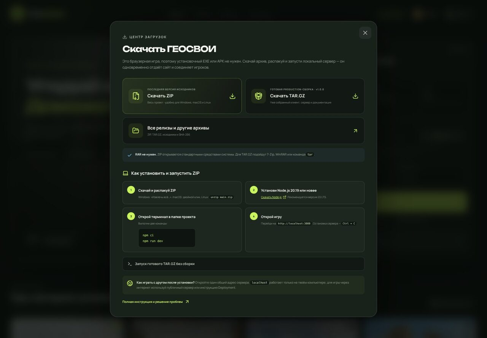

# Как скачать и запустить ГЕОСВОИ

ГЕОСВОИ — браузерное приложение. Отдельные EXE, APK или RAR-установщик не нужны: проект распространяется в ZIP и TAR.GZ, а локальный Node.js-сервер одновременно обслуживает сайт и WebSocket для совместной игры.



## Ссылки на скачивание

| Что скачать | Для чего | Ссылка |
|---|---|---|
| **ZIP с исходниками `main`** | Последняя версия, разработка, самостоятельная сборка | [Скачать ZIP](https://github.com/romanata10/the-street-view-game-by-ai-/archive/refs/heads/main.zip) |
| **Production TAR.GZ 1.0.0** | Готовый клиент и сервер без команды `npm run build` | [Скачать TAR.GZ](https://github.com/romanata10/the-street-view-game-by-ai-/releases/download/v1.0.0/geosvoi-1.0.0-production.tar.gz) |
| **Последний стабильный релиз** | Все доступные production ZIP/TAR.GZ, SHA-256 и исходники | [Открыть Releases](https://github.com/romanata10/the-street-view-game-by-ai-/releases/latest) |

В приложении эти ссылки также находятся в кнопке **«Скачать»** в верхней панели.

> Production ZIP и TAR.GZ формируются GitHub Actions из одного набора файлов. Для новых релизов workflow прикрепляет оба архива и отдельный `.sha256` для каждого. Специальный RAR не требуется: ZIP открывается встроенными средствами Windows, macOS и Linux.

## Вариант 1. ZIP с исходниками

### 1. Распакуйте архив

- **Windows:** нажмите правой кнопкой по ZIP → **«Извлечь всё…»**.
- **macOS:** откройте ZIP двойным кликом.
- **Linux:** используйте файловый менеджер или команду:

```bash
unzip main.zip
cd the-street-view-game-by-ai--main
```

GitHub формирует имя папки автоматически, поэтому оно может немного отличаться. Перейдите в папку, внутри которой находятся `package.json`, `src`, `server` и `shared`.

### 2. Установите Node.js

Нужен **Node.js 20.19+**, рекомендуется **Node.js 22 LTS**.

[Скачать Node.js с официального сайта](https://nodejs.org/en/download).

Проверьте установку:

```bash
node --version
npm --version
```

### 3. Установите зависимости и запустите игру

Откройте терминал в папке проекта:

```bash
npm ci
npm run dev
```

После сообщения `ГЕОСВОИ запущены` откройте:

```text
http://localhost:3000
```

Остановить сервер можно клавишами **Ctrl + C**. При следующем запуске достаточно команды `npm run dev`; повторно выполнять `npm ci` после каждого закрытия не нужно.

## Вариант 2. Готовый production-архив

Production-архив уже содержит собранный `dist`, поэтому Vite и TypeScript для запуска не нужны.

### ZIP

Распакуйте production ZIP и откройте терминал в папке `geosvoi-ВЕРСИЯ`.

### TAR.GZ

Windows 10/11, macOS и Linux могут распаковать его командой `tar`. Также подойдут 7-Zip и WinRAR:

```bash
tar -xzf geosvoi-1.0.0-production.tar.gz
cd geosvoi-1.0.0
```

### Запуск обоих форматов

```bash
npm ci --omit=dev
npm start
```

Откройте `http://localhost:3000`. В production-архиве нет исходного `src`; для изменения интерфейса или встраивания нового Google-ключа скачайте ZIP с исходниками.

## Проверка SHA-256

Если рядом с архивом есть `.sha256`, скачайте его в ту же папку.

Linux / macOS:

```bash
sha256sum -c geosvoi-1.0.0-production.tar.gz.sha256
```

Windows PowerShell:

```powershell
(Get-FileHash .\geosvoi-1.0.0-production.tar.gz -Algorithm SHA256).Hash
```

Сравните результат со строкой внутри `.sha256`. Регистр букв хеша значения не имеет.

## Google Street View

Без ключа доступны все встроенные демонстрационные панорамы, прогулка, избранное и совместное присутствие. Для реальных Google-сцен:

1. Создайте `.env` по примеру `.env.example`.
2. Добавьте `VITE_GOOGLE_MAPS_API_KEY=ваш_ключ`.
3. В исходниках выполните `npm run build`, затем запустите `npm start`.

Полная настройка: [GOOGLE_MAPS.ru.md](GOOGLE_MAPS.ru.md). Не отправляйте ключ в чат и не коммитьте `.env`.

## Как играть с другом после скачивания

`localhost` означает **текущий компьютер**. Если друг откроет `http://localhost:3000` на своём устройстве, он попадёт не на ваш сервер.

Варианты совместной игры:

- **Одна сеть:** разрешите порт 3000 в firewall и отправьте другу `http://IP_ВАШЕГО_КОМПЬЮТЕРА:3000`.
- **Интернет:** опубликуйте проект на сервере по [DEPLOYMENT.ru.md](DEPLOYMENT.ru.md) и отправьте публичный HTTPS-адрес.
- **Один компьютер для проверки:** откройте два разных браузера или обычное окно и инкогнито.

После этого хост создаёт матч или **«Погулять с другом»**, а гость заходит по ссылке/коду. В свободную прогулку можно войти даже после её начала.

## Частые проблемы

### `npm is not recognized` / `npm: command not found`

Node.js не установлен или терминал открыт до установки. Установите Node.js, закройте и заново откройте терминал.

### `EBADENGINE` или ошибка версии Node.js

Обновите Node.js до 20.19 или новее. Проверьте версию командой `node --version`.

### Порт 3000 уже занят

```bash
PORT=8080 npm run dev
```

Откройте `http://localhost:8080`.

### Друг не подключается по IP

Проверьте, что устройства находятся в одной сети, сервер запущен, порт разрешён firewall, а адрес не является `localhost`. Для публичного сервера также нужен WebSocket `/ws` на том же домене.

### Архив не открывается

Скачайте его ещё раз и проверьте SHA-256. Для TAR.GZ используйте 7-Zip/WinRAR либо выберите ZIP из последнего релиза. Не переименовывайте расширение архива вручную.
