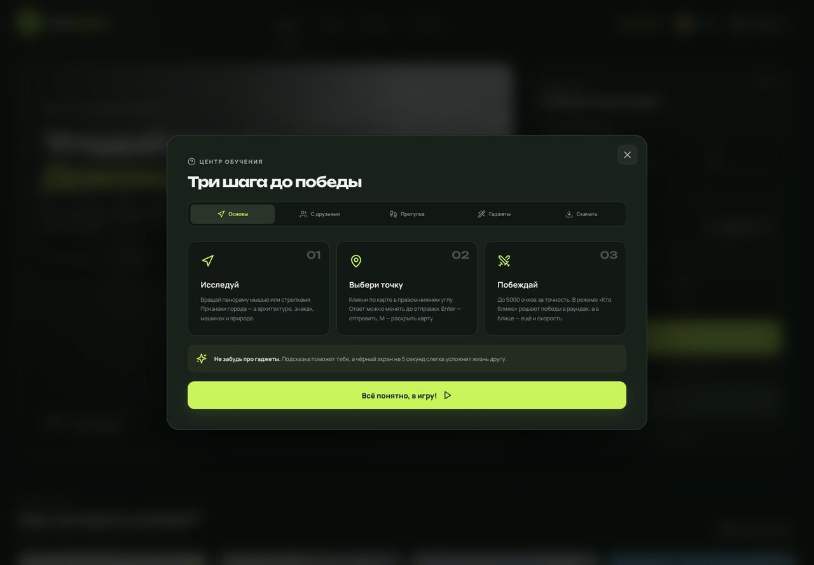
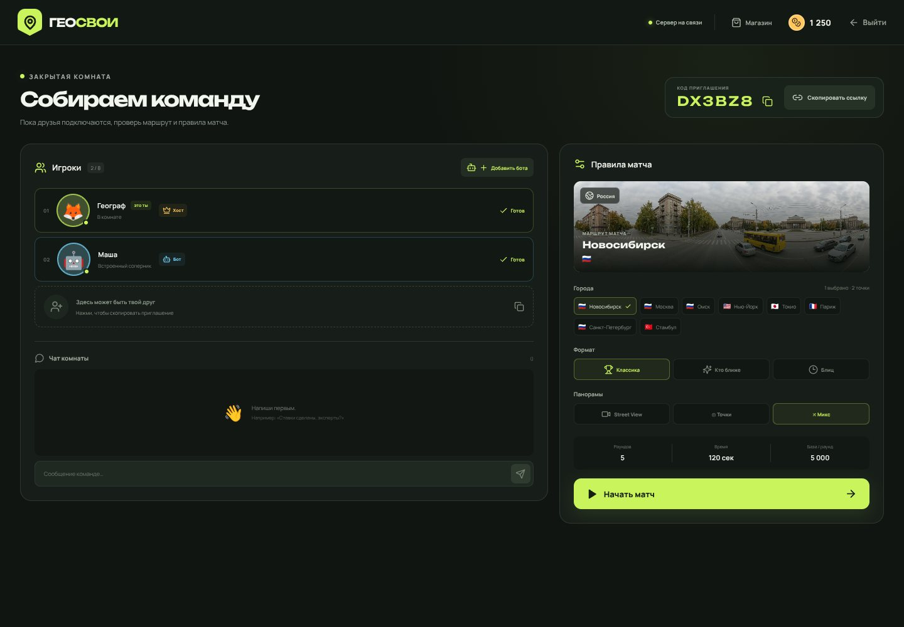
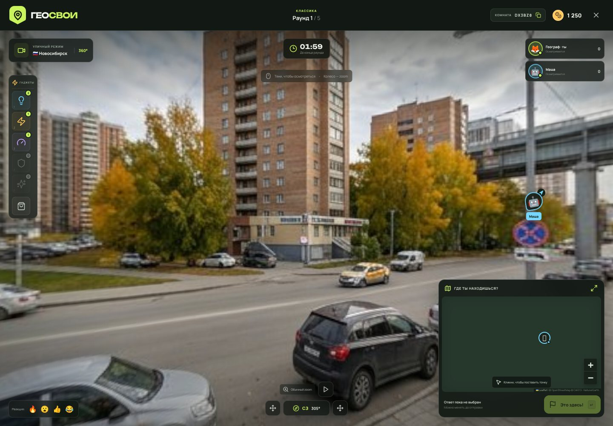
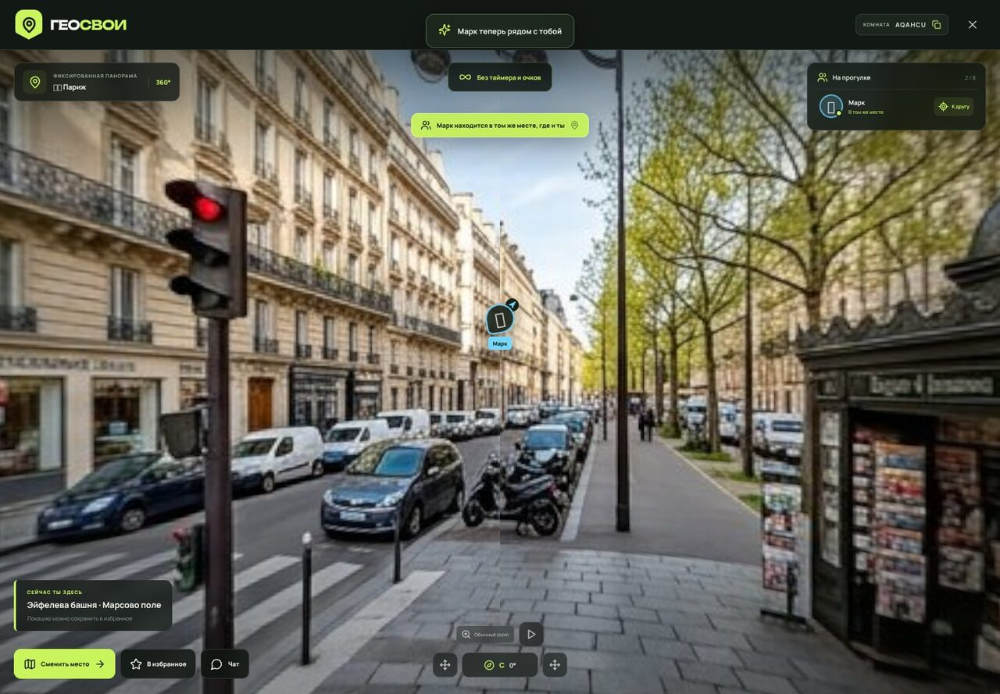
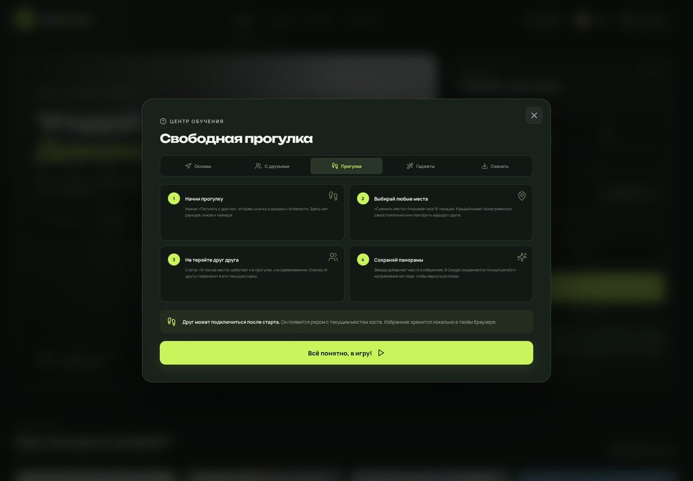
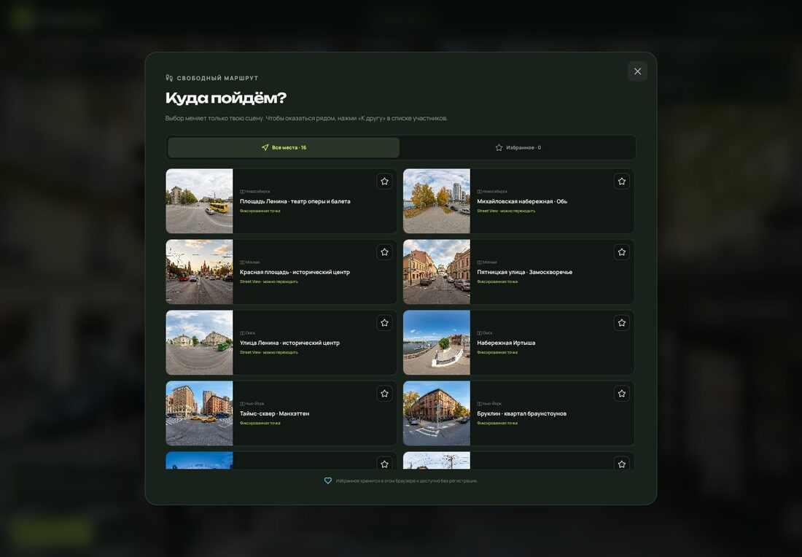
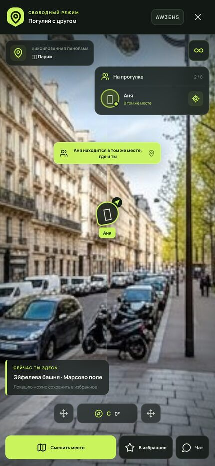

# Как играть в ГЕОСВОИ с друзьями

Это пошаговое руководство для хоста и гостей. Регистрация не нужна: достаточно открыть приложение в современном браузере.

В самой игре краткая версия всегда доступна через **«Как играть»**: вкладки **«С друзьями»**, **«Прогулка»** и **«Скачать»**.

## 1. Быстрый вариант для двух игроков

### Хост

1. Нажмите на профиль в правом верхнем углу и укажите имя.
2. Выберите один или несколько городов. Кнопка **«Выбрать весь мир»** включает все восемь городов.
3. Настройте формат, режим панорам, число раундов и время.
4. Нажмите **«Создать комнату»**.
5. В правой части лобби нажмите **«Скопировать ссылку»** и отправьте её другу любым мессенджером.

### Друг

**По ссылке:** просто откройте приглашение. Код комнаты подставится автоматически.

**По коду:**

1. Откройте приложение.
2. Нажмите **«Войти по коду»**.
3. Введите шесть букв/цифр без пробелов.
4. Нажмите **«Войти в игру»**.

### Перед матчем

- Гость нажимает **«Я готов играть»**.
- При необходимости напишите друг другу во встроенном чате.
- Хост может изменить правила или добавить бота.
- Когда все гости готовы, хост нажимает **«Начать матч»**.

> Если друг открыл ссылку на том же устройстве и в том же браузере, используйте второй браузер или окно инкогнито. Иначе локальный профиль будет общим. На разных устройствах ничего дополнительного не требуется.

## 2. Что происходит в раунде

Все игроки получают одинаковую начальную локацию и одинаковый таймер.

1. **Осмотритесь.** Вращайте панораму мышью или пальцем. В режиме Street View можно переходить по улицам, в фиксированной точке — только вращаться и приближать изображение.
2. **Найдите признаки места:** язык вывесок, сторону движения, номера машин, архитектуру, растения и рельеф.
3. **Поставьте точку на карте** в правом нижнем углу. Повторный клик передвигает ответ.
4. Нажмите **«Это здесь!»** или **Enter**. После отправки изменить ответ нельзя.
5. Дождитесь остальных игроков или окончания времени.

Раунд заканчивается досрочно, когда все активные игроки ответили. Если время вышло, у игроков без ответа будет ноль очков за раунд.

## 3. Результаты и следующий раунд

На экране результатов отображаются:

- правильная точка и название локации;
- ваш ответ и ответы друзей;
- расстояние до цели;
- очки и монеты за раунд;
- общий счёт игроков.

Хост нажимает **«Следующий раунд»**. После последнего раунда появляются итоги матча, подиум, кнопка реванша и магазин.

## 4. Форматы соревнования

| Формат | Как определяется победитель |
|---|---|
| **Классика** | Побеждает максимальная сумма очков. Точность важнее скорости. |
| **Кто ближе** | Самый близкий ответ получает победу в раунде. Итог определяется числом таких побед, затем очками. |
| **Блиц** | На раунд 45 секунд. К очкам за расстояние добавляется бонус за оставшееся время. |

Базовый результат — до **5000 очков** за раунд. «Риск-раунд» может удвоить его, а блиц добавляет временной бонус.

## 5. Режимы панорам

| Режим | Поведение при подключённом Google API |
|---|---|
| **Street View** | Реальная Google-панорама, переходы по улицам и навигационные стрелки. |
| **Панорамы** | Фиксированная Google-точка. Переходы отключены, вращение и zoom разрешены. |
| **Микс** | Одно из двух правил случайно выбирается каждый раунд. |

Без Google API используются встроенные иллюстративные сцены. Их внешний вид не является фотографией реальной координаты. Настройка описана в [GOOGLE_MAPS.ru.md](GOOGLE_MAPS.ru.md).

## 6. Как видеть друга

- **В панораме:** цветной аватар показывает направление взгляда друга. В Google-режиме аватар отображается, когда игроки находятся в одной `panoId`-сцене.
- **На мини-карте:** цветной курсор друга виден при движении его указателя по карте.
- **В списке игроков:** отображается статус «Осматривается», «Ответ готов» или **«Рядом с тобой»**.
- **Уведомление о встрече:** когда совпадают текущие `panoId` или встроенные локации, появляется сообщение «Игрок находится в том же месте, где и ты». Это работает во всех соревновательных форматах и в свободной прогулке.
- **После раунда:** ответы всех игроков появляются на карте с линиями до правильной точки.

Реальная координата текущей панорамы не подставляется на мини-карту до результата, поэтому присутствие друга не выдаёт ответ.

## 7. Гаджеты и монеты

| Клавиша | Предмет | Эффект |
|---|---|---|
| **1** | Гео-подсказка | Подсказка для конкретной локации. |
| **2** | Чёрный экран | Панорама выбранного соперника исчезает на 5 секунд. |
| **3** | Турбо-шаг | Ускорение камеры на 45 секунд. |
| **4** | Анти-лаг | Блокирует один чёрный экран и расходуется. |
| **5** | Риск-раунд | Удваивает очки текущего раунда; активируется до ответа. |
| Автоматически | Оптика PRO | Постоянное улучшение zoom после покупки. |

Монеты начисляются за отправленный ответ, набранные очки и самый близкий ответ. Магазин доступен в меню, лобби, матче и на экране итогов. Покупки сохраняются в браузере.

## 8. Полезные клавиши

- **Enter** — отправить выбранную точку.
- **M** — развернуть или свернуть карту.
- **1–5** — применить гаджет.
- **WASD / стрелки** — поворот встроенной камеры.
- **Колесо мыши** — zoom.

## 9. Если что-то не работает

### Комната не найдена

Проверьте все шесть символов. Код действует, пока существует серверная комната. После перезапуска сервера старые комнаты удаляются — создайте новую.

### «Этот матч уже начался»

В текущий матч нельзя войти новым игроком после старта. Дождитесь реванша или попросите хоста создать новую комнату. Отключившийся участник может вернуться по той же ссылке.

### Хост не может начать

Проверьте, что каждый гость нажал **«Я готов играть»**. Хосту и ботам отдельная готовность не требуется.

### Друг не подключается через интернет

Убедитесь, что оба открывают один публичный адрес приложения, а не `localhost` на разных устройствах. Сервер и WebSocket должны быть доступны на одном домене и пути `/ws`. Для обратного прокси включите WebSocket Upgrade — см. [DEPLOYMENT.ru.md](DEPLOYMENT.ru.md).

### Вместо Google показывается встроенная сцена

Проверьте индикатор API в настройках матча, ключ, доменные ограничения и покрытие Street View. Приложение автоматически переключается на резервную панораму, если API не отвечает или рядом нет снимков.

### Исчезли монеты или предметы

Профиль хранится в `localStorage` текущего браузера. Очистка данных сайта, другой браузер или инкогнито создадут отдельный профиль.

### Можно играть одному?

Да. Нажмите **«С ботом»** для мгновенного матча или создайте комнату и добавьте бота в лобби.

## 10. Свободный режим «Погуляй с другом»

Это отдельный совместный режим для спокойного исследования городов. В нём **нет таймера, ответов, очков, раундов и гаджетов**.

Краткая версия этих правил всегда доступна во вкладке **«Прогулка»** центра обучения.

### Как начать

1. На главной странице выберите стартовый маршрут и тип панорам.
2. Нажмите **«Погулять с другом»**.
3. Отправьте приглашение, дождитесь готовности и начните прогулку.
4. Друг может войти по ссылке даже после старта — он появится рядом с текущим местом хоста.

### Как менять места и находить друг друга

- **«Сменить место»** открывает все 16 локаций независимо от первоначального маршрута. Выбор меняет только вашу сцену, не перемещая остальных.
- В списке участников видно, кто находится **«В том же месте»**, а кто — **«В другом месте»**.
- Нажмите **«К другу»**, чтобы перейти к его локации. Если известен текущий Google `panoId`, откроется именно его сцена и направление взгляда.
- Общий чат доступен кнопкой **«Чат»**. Приглашение копируется нажатием на код комнаты.

На телефоне панель участников и кнопки остаются под рукой, а панорама занимает весь экран:

### Избранные панорамы

Нажмите **«В избранное»** на панели снизу или звезду на карточке локации. Вкладка **«Избранное»** в выборе места сохраняет:

- встроенную локацию;
- точный Google `panoId`, если панорама доступна;
- направление взгляда в момент сохранения.

Избранное хранится в `localStorage` текущего браузера и не требует регистрации. Очистка данных сайта удалит его, а другой браузер или устройство создаст отдельный список.
